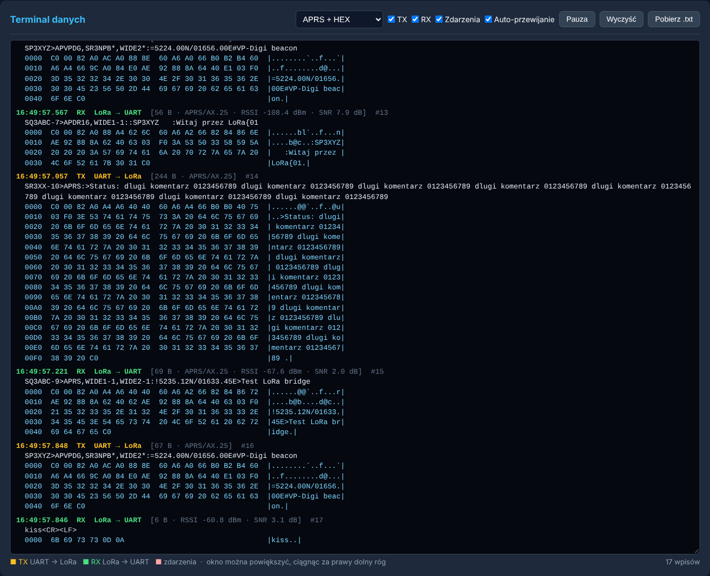

# LoRa UART Bridge — most KISS TNC przez LoRa 433 MHz

Przezroczysty, dwukierunkowy most **UART ↔ LoRa ↔ UART** na płytkach **TTGO LoRa32 (SX1278, 433 MHz)**.
Dwie płytki zastępują kabel szeregowy: wszystko, co wejdzie na UART jednej z nich, wychodzi — bajt w bajt —
z UART-u drugiej, i odwrotnie.

Główne zastosowanie: **przedłużenie łącza KISS z TNC [VP-Digi](https://github.com/sq8vps/vp-digi)**
(lub innego TNC/modemu APRS) do komputera, iGate'a albo drugiego TNC, oddalonego o setki metrów
lub kilka kilometrów, bez kładzenia kabla.

```
 ┌───────────┐  UART   ┌──────────────┐   LoRa 433 MHz   ┌──────────────┐  UART/USB  ┌──────────────────┐
 │  VP-Digi  │ ──────▶ │  TTGO LoRa32 │ ~~~~~~~~~~~~~~~▶ │  TTGO LoRa32 │ ─────────▶ │ PC / iGate / TNC │
 │ (KISS TNC)│ ◀────── │   węzeł N1   │ ◀~~~~~~~~~~~~~~~ │   węzeł N2   │ ◀───────── │ (program APRS)   │
 └───────────┘         └──────────────┘                  └──────────────┘            └──────────────────┘
```

---

## Spis treści

1. [Co robi program](#co-robi-program)
2. [Wymagany sprzęt](#wymagany-sprzęt)
3. [Podłączenie](#podłączenie)
4. [Kompilacja i wgrywanie](#kompilacja-i-wgrywanie)
5. [Pierwsze uruchomienie i konfiguracja](#pierwsze-uruchomienie-i-konfiguracja)
6. [Interfejs WWW i terminal danych](#interfejs-www-i-terminal-danych)
7. [Współpraca z VP-Digi](#współpraca-z-vp-digi)
8. [Protokół radiowy](#protokół-radiowy)
9. [Parametry LoRa i przepustowość](#parametry-lora-i-przepustowość)
10. [Diagnostyka i rozwiązywanie problemów](#diagnostyka-i-rozwiązywanie-problemów)
11. [Ograniczenia](#ograniczenia)
12. [Uwagi prawne](#uwagi-prawne)

---

## Co robi program

- **Przezroczysty most szeregowy** — dane z UART (lub USB) są pakowane w ramki LoRa i odtwarzane po drugiej
  stronie bez żadnych zmian. Most nie interpretuje treści, więc nadaje się do KISS, tekstu, NMEA, własnych protokołów.
- **Świadome ramkowanie KISS** — ramka KISS (`C0 … C0`) jest zawsze przesyłana w całości jako jedna wiadomość,
  również gdy w danych są sekwencje escape (`DB DC`, `DB DD`) i gdy nadawca robi przerwy między bajtami.
  Tekst dzielony jest po znaku końca linii, inne dane — po chwili ciszy na linii.
- **Fragmentacja z gwarancją całości** — wiadomość dłuższa niż 240 B dzielona jest na kilka pakietów LoRa.
  Odbiorca wypuszcza ją na UART **tylko w całości**; jeśli zginie choćby jeden fragment, cała wiadomość jest
  odrzucana. Dzięki temu TNC nigdy nie dostanie uciętej ramki KISS (którą mógłby nadać w eter jako śmieci).
- **Unikanie kolizji** — przed nadaniem sprawdzane jest, czy w kanale nie trwa odbiór, a następnie wykonywane
  jest CAD (Channel Activity Detection) układu SX1278. Przy zajętym kanale most odczekuje losowy czas.
- **Adresowanie węzłów** — każda płytka ma swoje ID i ID partnera, więc kilka par mostów może pracować na
  tej samej częstotliwości, a obce pakiety LoRa (np. sieci LoRa APRS) są ignorowane.
- **Interfejs WWW** (WiFi AP lub sieć domowa) — statystyki na żywo, **terminal danych** pokazujący każdą
  przesłaną wiadomość (dekodowanie APRS/AX.25, pełny zrzut HEX), **wysyłanie tekstu lub bajtów z klawiatury**,
  pełna konfiguracja zapisywana w pamięci flash.
- **Ekran OLED** — ID węzłów, adres IP, parametry radia, liczniki TX/RX, RSSI/SNR, ostrzeżenie o złym ID.
- **Automatyczne rozpoznawanie rewizji płytki** — jeden program działa na TTGO LoRa32 V1, V2 i V2.1 (T3 V1.6.x).
- **Zegar NTP** (gdy płytka jest w sieci WiFi) — czas zdarzeń w terminalu, strefa czasowa Polski (CET/CEST).

## Wymagany sprzęt

### Płytki — potrzebne są **dwie** jednakowe

| Rewizja (nadruk na płytce)                       | Układ ESP32     | Wspierana | Uwagi |
|--------------------------------------------------|-----------------|:---------:|-------|
| **T3_V1.6 / T3_V1.6.1** (w Arduino: „V2.1 1.6.1”) | ESP32-PICO-D4   | ✅ | Najczęściej spotykana, **zalecana**. Testowana. |
| TTGO LoRa32 **V2** (T3 V1.3/V1.4)                 | ESP32-D0WDQ6    | ✅ | |
| TTGO LoRa32 **V1** (OLED na GPIO4/15)             | ESP32-D0WDQ6    | ✅ | UART TX na GPIO23 zamiast 15 |

- Układ radiowy: **Semtech SX1278 (433 MHz)**. Wersje 868/915 MHz (SX1276) zadziałają po zmianie częstotliwości
  w ustawieniach, ale program był pisany i sprawdzany dla 433 MHz.
- Ekran OLED SSD1306 128×64 (wbudowany) — opcjonalny, bez niego most działa normalnie.
- **Antena 433 MHz podłączona przed włączeniem!** Nadawanie bez anteny może uszkodzić tor nadawczy SX1278.
- Zasilanie: USB 5 V, min. 500 mA (start WiFi i nadawanie LoRa dają skoki poboru prądu —
  słaby kabel/port powoduje restarty typu BROWNOUT).

Rewizja jest rozpoznawana automatycznie przy starcie (typ układu ESP32 + wyszukanie ekranu OLED na I²C),
więc w Arduino IDE można wybrać dowolną rewizję płytki „TTGO LoRa32-OLED”.

> **Dlaczego to ważne:** w ESP32-PICO-D4 (T3 V1.6) piny GPIO16/17 są połączone z wewnętrzną pamięcią flash.
> Programy pisane dla starszych płytek resetują OLED przez GPIO16, co na T3 V1.6 zawiesza procesor
> (pętla restartów `INT_WDT`). Ten program nie dotyka GPIO16/17 na układach PICO.

### Piny używane przez program

| Funkcja               | V2.1 / T3 V1.6 | V2   | V1   |
|-----------------------|:--------------:|:----:|:----:|
| LoRa SCK / MISO / MOSI| 5 / 19 / 27    | 5 / 19 / 27 | 5 / 19 / 27 |
| LoRa CS / DIO0        | 18 / 26        | 18 / 26 | 18 / 26 |
| LoRa RST              | 23             | 12   | 14   |
| OLED SDA / SCL        | 21 / 22        | 21 / 22 | 4 / 15 |
| OLED RST              | —              | 16   | 16   |
| **UART RX** (← TX urządzenia) | **13** | **13** | **13** |
| **UART TX** (→ RX urządzenia) | **15** | **15** | **23** |

## Podłączenie

### TTGO ↔ VP-Digi (STM32 „Blue Pill”)

| TTGO LoRa32 (T3 V1.6) | VP-Digi           |
|-----------------------|-------------------|
| GPIO13 (RX mostu)     | PA9  — TX UART1   |
| GPIO15 (TX mostu)     | PA10 — RX UART1   |
| GND                   | GND               |

- Linie są **skrzyżowane** (TX → RX). **Wspólna masa jest obowiązkowa.**
- Obie strony pracują w logice **3,3 V** — łączysz bezpośrednio, bez konwertera poziomów.
- Można też użyć UART2 VP-Digi (PA2 = TX, PA3 = RX).
- Na T3 V1.6/V2 piny 13 i 15 są wspólne ze slotem microSD — **nie wkładaj karty**.
- Nie zasilaj TTGO z pinu 3,3 V Blue Pilla — jego stabilizator nie wytrzyma WiFi i nadawania.

### Druga strona

- **Do komputera:** w ustawieniach mostu wybierz port **USB**. Program APRS (APRSIS32, YAAC, Xastir, PinPoint,
  Direwolf jako klient KISS itp.) ustaw na **KISS przez port COM** płytki, z tą samą prędkością co w moście.
- **Do drugiego TNC / urządzenia:** UART jak wyżej (GPIO13 / GPIO15 / GND).

## Kompilacja i wgrywanie

### Wymagane oprogramowanie

| Składnik | Wersja | Skąd |
|----------|--------|------|
| Arduino IDE | 2.x | arduino.cc |
| Rdzeń ESP32 (Espressif) | **3.x** (sprawdzane z 3.3.12; 2.x też powinien działać) | Menedżer płytek, URL: `https://espressif.github.io/arduino-esp32/package_esp32_index.json` |
| **RadioLib** (Jan Gromeš) | **7.x** (sprawdzane z 7.8.1) | Menedżer bibliotek |
| Adafruit SSD1306 | 2.5.x | Menedżer bibliotek |
| Adafruit GFX Library | 1.11+ | Menedżer bibliotek (instaluje się z SSD1306) |

> RadioLib 8.x (gałąź rozwojowa) zmienia sygnaturę `begin()` — jeśli pojawi się, zostań przy 7.x.

### Kroki

1. Sklonuj repozytorium lub pobierz ZIP i otwórz `lora_bridge/lora_bridge.ino`
   (Arduino wymaga, by plik `.ino` leżał w katalogu o tej samej nazwie).
2. **Narzędzia → Płytka → esp32 → „TTGO LoRa32-OLED”** (dowolna *Revision*) albo „ESP32 Dev Module”.
3. Wgraj na **obie** płytki ten sam program.

Program można też wgrać bez IDE, z pliku `.bin` zbudowanego przez *Szkic → Eksportuj skompilowany plik binarny*:

```
esptool.py erase_flash
esptool.py write_flash 0x0 lora_bridge.ino.merged.bin
```

## Pierwsze uruchomienie i konfiguracja

1. Po starcie każda płytka wystawia sieć WiFi **`LoRa-Bridge-Node-<ID>`**, hasło **`12345678`**.
2. Połącz się i otwórz **http://192.168.4.1**.
3. Ustaw ID węzłów — **muszą być odwrócone**:

   | | Płytka przy VP-Digi | Płytka przy PC |
   |---|:---:|:---:|
   | ID tego urządzenia | 1 | 2 |
   | ID urządzenia docelowego | 2 | 1 |

   Domyślnie obie płytki mają 1 → 2 — **na drugiej trzeba to zmienić**, inaczej nic nie przejdzie
   (most to wykryje i wyświetli ostrzeżenie na stronie i na OLED).
4. Ustaw **identyczne** parametry radia na obu płytkach (częstotliwość, BW, SF, CR, SyncWord).
5. Ustaw prędkość UART zgodną z urządzeniem (VP-Digi domyślnie: **9600 Bd, 8N1**).
6. Opcjonalnie podaj SSID i hasło swojej sieci WiFi — płytka połączy się z nią (i zsynchronizuje zegar NTP
   z `tempus1.gum.gov.pl`), a punkt dostępowy zostanie aktywny równolegle. Adres IP widać na OLED.

Ustawienia zapisywane są w pamięci flash (NVS) i przetrwają restart.

### Ustawienia domyślne

| Parametr | Wartość |
|----------|---------|
| ID węzła → ID partnera | 1 → 2 |
| UART | 9600 Bd, 8N1, port UART2 (GPIO13/15) |
| Timeout ciszy UART | 15 ms (dla ramek KISS wydłużany automatycznie) |
| Częstotliwość | 434,000 MHz |
| BW / SF / CR | 125 kHz / SF8 / 4/5 |
| Moc | 17 dBm |
| SyncWord | 0x4B |

## Interfejs WWW i terminal danych



**Statystyki na żywo:** wiadomości i ramki TX/RX, ramki KISS/AX.25, pakiety słyszane w eterze (także obce),
RSSI/SNR, błędy CRC, zgubione fragmenty, odrzucone wiadomości, odczekania na wolny kanał, czas nadawania
pełnej ramki, stan radia. Ostrzeżenia o niezgodnych ID węzłów i o tym, że słychać tylko obcy system LoRa.

**Terminal danych** (≈50 linii, okno można powiększać):

- każda wiadomość w obu kierunkach: **TX** (UART → LoRa) i **RX** (LoRa → UART), czas z milisekundami,
  długość, RSSI/SNR;
- ramki KISS dekodowane do postaci TNC2, np. `SQ3ABC-9>APRS,WIDE1-1:!5235.12N/01633.45E>komentarz`;
- pełny zrzut HEX (16 bajtów w wierszu + kolumna ASCII);
- zdarzenia: błędy CRC, zgubione fragmenty, pakiety dla innego ID, obce pakiety LoRa, błędy nadawania, start płytki;
- widoki: *APRS + HEX*, *tylko APRS/tekst*, *tylko HEX*, *surowe ASCII*; filtry TX / RX / zdarzenia;
  pauza, czyszczenie, **pobranie logu do pliku .txt**;
- ESP32 pamięta **100 ostatnich wpisów**, więc po otwarciu strony widać również to, co przeszło wcześniej.

**Wysyłanie z klawiatury** — pole pod terminalem:

- **Enter** wysyła wpisany tekst przez LoRa na UART drugiej płytki;
- zakończenie linii do wyboru: CR+LF, CR, LF lub brak;
- tryb **HEX** — wysyła dowolne bajty, np. `C0 00 82 A0 … C0` (ręczna ramka KISS);
- strzałki **↑ / ↓** — historia poprzednich wpisów.

### API HTTP

| Metoda | Ścieżka | Opis |
|--------|---------|------|
| GET  | `/api/status` | statystyki (JSON) |
| GET  | `/api/config` | bieżąca konfiguracja (bez hasła WiFi) |
| GET  | `/api/log?since=<id>&boot=<id>` | historia wiadomości i zdarzeń (JSON, przyrostowo) |
| POST | `/api/send` | wysłanie danych: `msg`, `mode=text\|hex`, `eol=crlf\|cr\|lf\|none` |
| POST | `/save` | zapis konfiguracji (formularz) |
| POST | `/reboot` | restart ESP32 |

## Współpraca z VP-Digi

Na podstawie analizy kodu źródłowego VP-Digi 2.2 (`kiss.c`, `uart.c`, `main.c`):

- VP-Digi wysyła na port KISS ramki w formacie `C0 00 <AX.25 bez FCS> C0` — **tylko ramki odebrane z radia**.
  **Własne beacony i ramki digipeatowane trafiają na KISS dopiero po włączeniu `monkiss on`**
  (domyślnie wyłączone). Jeśli chcesz je widzieć po drugiej stronie mostu, w terminalu VP-Digi wpisz:
  ```
  config
  monkiss on
  save
  ```
- Każdą poprawną ramkę KISS otrzymaną z UART VP-Digi **natychmiast nadaje w eterze 2 m**.
- VP-Digi przyjmuje ramki AX.25 o długości **do 328 bajtów** (dłuższe odrzuca) — terminal mostu ostrzega
  przy dłuższych ramkach.
- **Tekst zakończony Enterem VP-Digi traktuje jako polecenie terminala, także w trybie KISS.**
  `config` lub `monitor` wyłączą tryb KISS na tym porcie. Przywrócisz go poleceniem `kiss` lub restartem.
  Uważaj więc, co wysyłasz z klawiatury w terminalu mostu.
- Domyślne ustawienia portów VP-Digi (9600 Bd, tryb KISS) pasują do domyślnych ustawień mostu.

## Protokół radiowy

Każdy pakiet LoRa (jawny nagłówek, CRC włączone) ma 5-bajtowy nagłówek i do 240 B danych:

```
 bajt:   0        1         2         3       4        5 … 244
       ┌──────┬────────┬────────┬───────┬───────┬────────────────┐
       │ 0xA5 │ SENDER │ TARGET │  SEQ  │ FLAGS │  dane (≤240 B) │
       └──────┴────────┴────────┴───────┴───────┴────────────────┘
 FLAGS: bit0 = pierwszy fragment wiadomości, bit1 = ostatni fragment
```

- `SEQ` rośnie o 1 z każdym pakietem (0–255, zawija się). Luka w numeracji = zgubiony pakiet →
  bieżąca wiadomość jest odrzucana w całości.
- Pakiety bez znacznika `0xA5` lub z innymi ID są ignorowane (liczone w statystykach jako obce).
- Maksymalna długość jednej wiadomości: 1024 B (ramka KISS z APRS ma typowo < 400 B).

## Parametry LoRa i przepustowość

Przy ustawieniach domyślnych (SF8, BW 125 kHz, CR 4/5) pełny pakiet (245 B) nadawany jest ok. **0,7 s**,
co daje ok. **2,5–3 kbit/s** użytecznej przepustowości. Dla APRS (pojedyncze ramki co kilka sekund) to z dużym
zapasem; ciągłego strumienia 9600 Bd most nie przeniesie.

| Ustawienie | Zasięg | Szybkość |
|-----------|--------|----------|
| SF7 / 250 kHz | mniejszy | najszybciej |
| **SF8 / 125 kHz** (domyślnie) | dobry kompromis | ~3 kbit/s |
| SF10–12 / 125 kHz | największy | bardzo wolno (sekundy na ramkę) |

Czas nadawania pełnej ramki dla bieżących ustawień jest pokazywany na stronie WWW.

## Diagnostyka i rozwiązywanie problemów

### Monitor portu szeregowego (USB, 115200 Bd)

Gdy most pracuje na UART2 (domyślnie), przy starcie na USB wypisywane są kroki `[0]`–`[12]`:

```
[0] Poprzedni reset: POWERON (wlaczenie zasilania)
[2] Uklad: ESP32-PICO-D4, flash 4 MB, PSRAM: nie
[3] Plytka: TTGO V2.1 (PICO-D4) | OLED SDA 21 SCL 22: znaleziony | LoRa RST 23
[8] Radio: OK (kod 0)
[12] Watki: OK OK OK — start zakonczony
```

Linia `[0]` podaje przyczynę **poprzedniego** restartu — przy pętli restartów wskazuje problem.

### Typowe problemy

| Objaw | Przyczyna / rozwiązanie |
|-------|-------------------------|
| Pętla restartów, `[0] BROWNOUT` | Za słabe zasilanie — krótszy kabel, inny port/zasilacz, odłącz VP-Digi na próbę. |
| Pętla restartów, `INT_WDT` | Inny program sterujący GPIO16 na T3 V1.6 — wgraj ten program (`erase_flash` przed wgraniem). |
| OLED / strona: „ZLE ID! slysze N1>N2” | Obie płytki mają te same ID — ustaw odwrócone (1→2 i 2→1). |
| Strona: „odbierane są tylko pakiety innego systemu” | Różne parametry radia na płytkach — wyrównaj częstotliwość, SF, BW, CR, SyncWord. |
| „Słyszane w eterze” = 0 | Płytki się nie słyszą: antena, odległość, parametry radia. |
| Brak wpisów TX przy VP-Digi | VP-Digi nic nie wysyła: sprawdź przewody (skrzyżowane, wspólna masa), tryb `kiss`, `monkiss on`, prędkość. |
| RX jest, ale VP-Digi nie nadaje | Prędkość UART, za długa ramka (>328 B), VP-Digi przełączony w tryb `config`/`monitor`. |
| Program APRS na PC resetuje płytkę | Wyłącz w programie sterowanie liniami DTR/RTS. |
| Błąd kompilacji `'Config' was not declared in this scope` | Używasz zmodyfikowanej wersji, w której struktura jest definiowana po pierwszej funkcji — Arduino IDE wstawia automatyczne prototypy przed pierwszą funkcją, więc wszystkie `struct` muszą być zdefiniowane wcześniej. |

## Ograniczenia

- **Brak potwierdzeń i retransmisji (ACK/ARQ)** — zgubiona wiadomość jest odrzucana, a nie powtarzana.
  Dla APRS jest to właściwe zachowanie (jak w eterze), dla protokołów wymagających pewnego dostarczenia — nie.
- Łącze półdupleksowe: w danej chwili nadaje tylko jedna strona.
- Most punkt-punkt (jedna para ID). Kilka par może dzielić częstotliwość, ale dzielą też czas antenowy.
- Hasło punktu dostępowego (`12345678`) jest stałe w kodzie — zmień je w `initWiFiAndNTP()` przed użyciem
  w miejscu publicznym.

## Uwagi prawne

- Domyślna częstotliwość to **434,000 MHz** — celowo **nie** 433,775 MHz, który jest kanałem sieci LoRa APRS.
- Dobierz częstotliwość i moc zgodnie z bandplanem i swoimi uprawnieniami:
  - na **licencji krótkofalarskiej** — w paśmie 70 cm (430–440 MHz) zgodnie z bandplanem IARU R1 / PZK;
  - **bez licencji** — tylko pasmo ISM 433,05–434,79 MHz z mocą do **10 mW e.r.p.** (ok. 10 dBm) i ograniczeniem
    czasu nadawania; domyślne 17 dBm jest wtedy za dużo.
- Ramki przesłane przez most do VP-Digi są przez niego **nadawane w eterze** — wysyłaj tylko ramki ze swoim znakiem.

---

Autor: **SP3WRO**. Projekt współpracuje z [VP-Digi](https://github.com/sq8vps/vp-digi) (SQ8VPS),
korzysta z bibliotek [RadioLib](https://github.com/jgromes/RadioLib) oraz Adafruit SSD1306/GFX.
